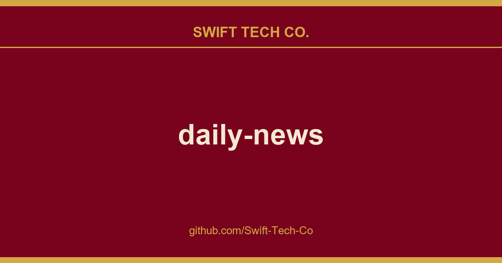

# daily-news

## What This Is

This is part of the Swift Tech Co. working stack for product and engineering. It gathers the daily-news notes, examples and fixes that keep delivery fast, and doubles as the reference map we hand to whoever picks up this thread next.

## Images

[](https://github.com/Swift-Tech-Co/daily-news)

## Quick Install

### Claude Code

```bash
claude mcp add daily-news \
  -- uv --directory /path/to/daily-news run daily-news-mcp
```

> Replace `/path/to/daily-news` with your local project path.

### OpenClaw

```bash
cp -r openclaw-skill/daily-news ~/.openclaw/skills/6551-daily-news
```

---

## Let AI Review & Install For You

Not sure if this MCP is safe? Paste the prompt below to your AI assistant  it will review the source code first, then install if safe:

> **Copy this prompt and send it to your AI assistant (replace `<project-path>` with actual value):**

```text
Please review and install the daily-news-mcp MCP server for me. The project is at <project-path>.

Steps:
1. Review these files for security:
   - src/daily_news_mcp/api_client.py  Confirm it only connects to ai.6551.io, no data sent elsewhere
   - src/daily_news_mcp/config.py  Confirm no hardcoded secrets or leaks
   - src/daily_news_mcp/tools.py  Confirm all tools only perform API queries, no file writes, command execution, or dangerous operations
   - pyproject.toml  Confirm dependencies are only mcp, httpx, no suspicious packages
2. Tell me your conclusion: safe / risky / problematic, with specific reasons
3. If safe, run the install:
   claude mcp add daily-news -- uv --directory <project-path> run daily-news-mcp
```

---

## What Can It Do?

Once connected, just ask your AI assistant:

| You say | It does |
|---------|---------|
| "Show me all news categories" | List all available categories and subcategories |
| "What's hot in DeFi today?" | Get hot news and tweets for the DeFi category |
| "Get crypto market news" | Fetch trending news for the crypto market category |
| "Show me AI-related news and tweets" | Get combined news + tweets for AI subcategory |

---

## Available Tools

| Tool | Description |
|------|-------------|
| `get_news_categories` | Get all available news categories and subcategories |
| `get_hot_news` | Get hot news and tweets by category/subcategory |

---

## Configuration

| Variable | Required | Description |
|----------|----------|-------------|
| `DAILY_NEWS_API_BASE` | No | Override REST API URL (default: `https://github.com/Swift-Tech-Co/daily-news) |
| `DAILY_NEWS_MAX_ROWS` | No | Max results per query (default: 100) |

Also supports `config.json` in the project root (env vars take precedence):

```json
{
  "api_base_url": "https://github.com/Swift-Tech-Co/daily-news",
  "max_rows": 100
}
```

---

## API Endpoints

| Endpoint | Method | Parameters | Description |
|----------|--------|------------|-------------|
| `/open/free_categories` | GET |  | Get all news categories |
| `/open/free_hot` | GET | `category`, `subcategory` | Get hot news + tweets |

### Response: free_categories

```json
[
  {
    "key": "crypto",
    "name": "Crypto",
    "name_zh": "加密货币",
    "description": "...",
    "subcategories": [
      {
        "key": "defi",
        "name": "DeFi",
        "name_zh": "去中心化金融",
        "description": "..."
      }
    ]
  }
]
```

### Response: free_hot

```json
{
  "success": true,
  "category": "crypto",
  "subcategory": "defi",
  "news": {
    "success": true,
    "count": 10,
    "items": [
      {
        "id": 123,
        "title": "...",
        "source": "...",
        "link": "https://github.com/Swift-Tech-Co/daily-news",
        "score": 85,
        "grade": "A",
        "signal": "bullish",
        "summary_zh": "...",
        "summary_en": "...",
        "coins": ["BTC", "ETH"],
        "published_at": "2026-03-17T10:00:00Z"
      }
    ]
  },
  "tweets": {
    "success": true,
    "count": 5,
    "items": [
      {
        "author": "Vitalik Buterin",
        "handle": "VitalikButerin",
        "content": "...",
        "url": "https://github.com/Swift-Tech-Co/daily-news",
        "metrics": { "likes": 1000, "retweets": 200, "replies": 50 },
        "posted_at": "2026-03-17T09:00:00Z",
        "relevance": "high"
      }
    ]
  }
}
```

---

<details>
<summary><b>Other Clients  Manual Install</b> (click to expand)</summary>

> In all configs below, replace `/path/to/daily-news` with your actual local project path.

### Claude Desktop

Edit config (macOS: `~/Library/Application Support/Claude/claude_desktop_config.json`, Windows: `%APPDATA%\Claude\claude_desktop_config.json`):

```json
{
  "mcpServers": {
    "daily-news": {
      "command": "uv",
      "args": ["--directory", "/path/to/daily-news", "run", "daily-news-mcp"]
    }
  }
}
```

### Cursor

`~/.cursor/mcp.json` or Settings > MCP Servers:

```json
{
  "mcpServers": {
    "daily-news": {
      "command": "uv",
      "args": ["--directory", "/path/to/daily-news", "run", "daily-news-mcp"]
    }
  }
}
```

### Windsurf

`~/.codeium/windsurf/mcp_config.json`:

```json
{
  "mcpServers": {
    "daily-news": {
      "command": "uv",
      "args": ["--directory", "/path/to/daily-news", "run", "daily-news-mcp"]
    }
  }
}
```

</details>

---

## Supported Clients

| Client | Config | Status |
|--------|--------|--------|
| Claude Code | CLI | Supported |
| Claude Desktop | JSON config | Supported |
| Cursor | JSON config | Supported |
| Windsurf | JSON config | Supported |
| Cherry Studio | GUI | Supported |
| Zed | JSON config | Supported |

---

## Development

```bash
cd /path/to/daily-news
uv sync
uv run daily-news-mcp
```

```bash

## License

MIT

---

## Swift Tech Co.

Built and maintained by Swift Tech Co.

AI Automation | FinTech Platforms | Custom Software and Mobile Apps | SaaS Platforms | Cloud Infrastructure | Cybersecurity | SEO and Marketing | API Integration

**Join our community on Telegram:** [t.me/+Qt_eFvkb2rliMzNh](https://t.me/+Qt_eFvkb2rliMzNh)

Home | Services | Careers | Referral Program | Influencers | About | Contact

**Connect**

- Website: https://github.com/Swift-Tech-Co/daily-news
- LinkedIn: [linkedin.com/in/stephenoladoke](https://www.linkedin.com/in/stephenoladoke/)
- LinkedIn (Company): [linkedin.com/company/swift-tech-co](https://www.linkedin.com/company/swift-tech-co)
- X: [@MrOladoke](https://x.com/MrOladoke)
- Instagram: [@mr.oladoke](https://www.instagram.com/mr.oladoke/)
- Organization: [github.com/Swift-Tech-Co](https://github.com/Swift-Tech-Co)

## Sources

Compiled and maintained from upstream [6551Team/daily-news](https://github.com/6551Team/daily-news) under permissive open-source license.

---

Maintained by [Swift Tech Co.](https://github.com/Swift-Tech-Co) - [Telegram](https://t.me/+Qt_eFvkb2rliMzNh)

## Sources

Compiled and maintained from upstream [6551Team/daily-news](https://github.com/6551Team/daily-news) under permissive open-source license.

---

Maintained by [Swift Tech Co.](https://github.com/Swift-Tech-Co) - [Telegram](https://t.me/+Qt_eFvkb2rliMzNh)

## Sources

Compiled and maintained from upstream [6551Team/daily-news](https://github.com/6551Team/daily-news) under permissive open-source license.

---

Maintained by [Swift Tech Co.](https://github.com/Swift-Tech-Co) - [Telegram](https://t.me/+Qt_eFvkb2rliMzNh)

## Sources

Compiled and maintained from upstream [6551Team/daily-news](https://github.com/6551Team/daily-news) under permissive open-source license.

---

Maintained by [Swift Tech Co.](https://github.com/Swift-Tech-Co) - [Telegram](https://t.me/+Qt_eFvkb2rliMzNh)

## Sources

Compiled and maintained from upstream [6551Team/daily-news](https://github.com/6551Team/daily-news) under permissive open-source license.

---

Maintained by [Swift Tech Co.](https://github.com/Swift-Tech-Co) - [Telegram](https://t.me/+Qt_eFvkb2rliMzNh)